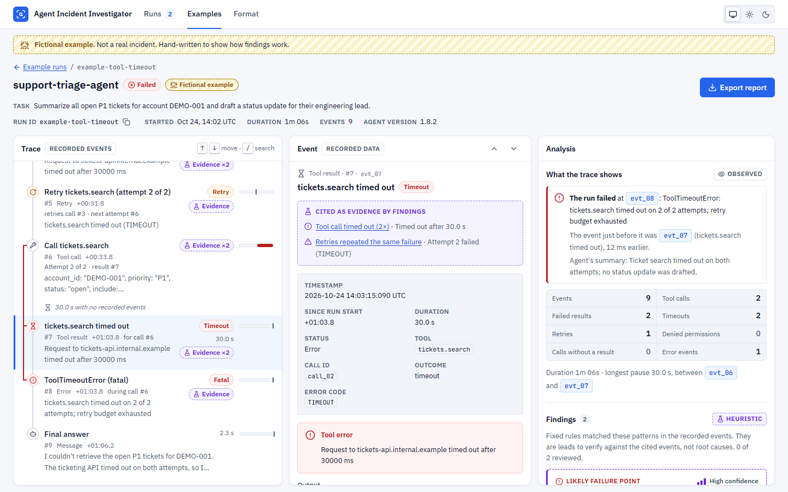
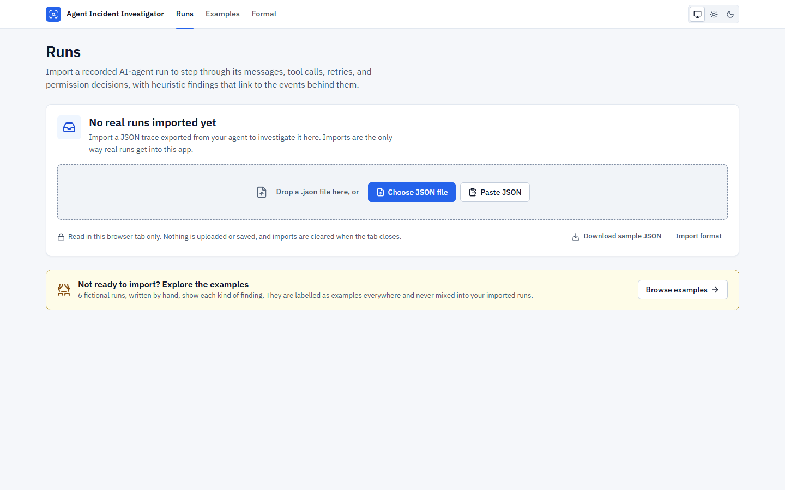
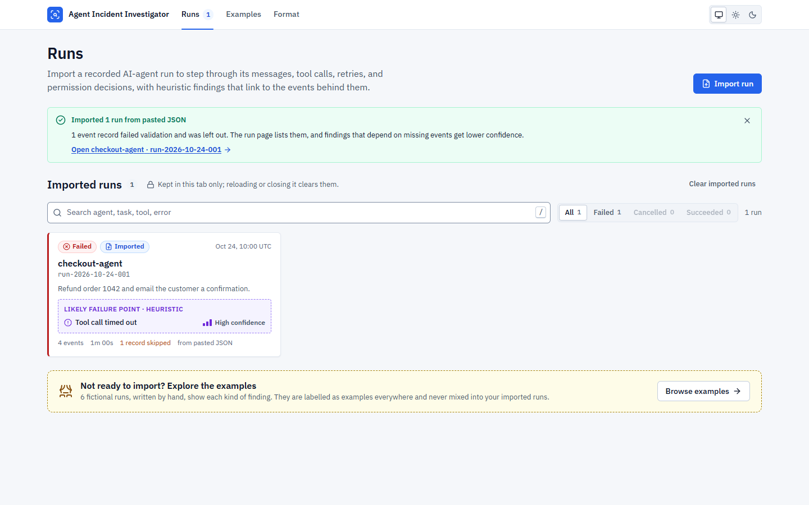
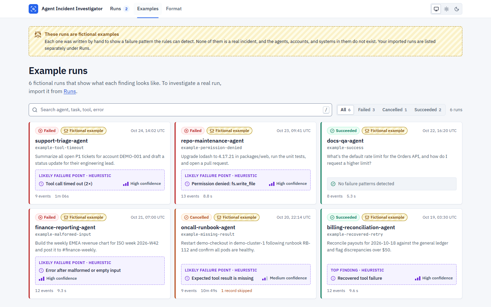
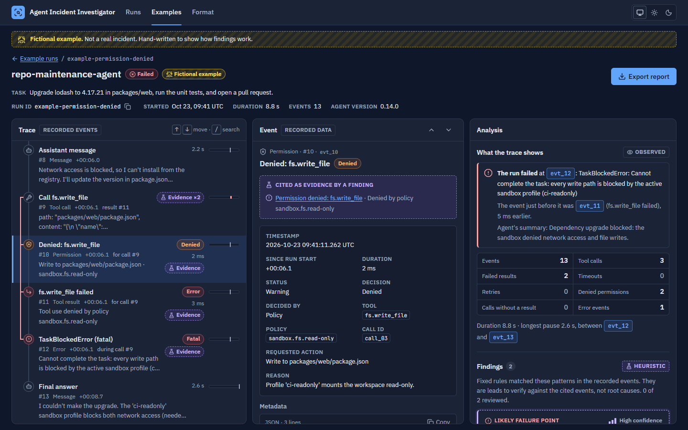
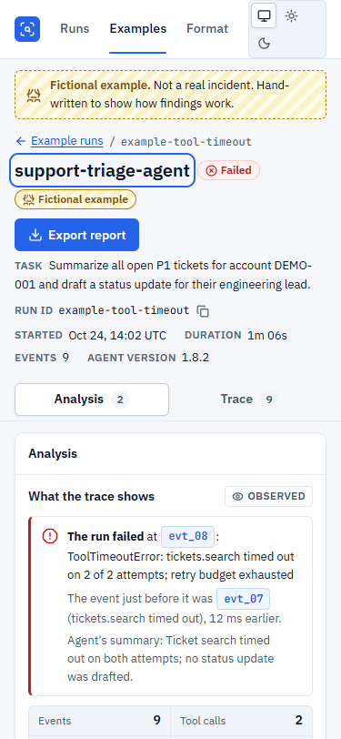
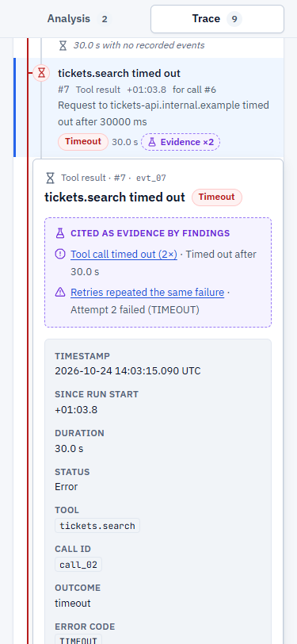

# Agent Incident Investigator

Import a recorded AI-agent run and investigate why it failed. The app lays out the run's
messages, tool calls, retries, and permission decisions as a trace, and runs deterministic
rules that point at likely failure points. Every finding cites the events behind it and
keeps what the trace shows separate from what the rule infers. An optional summary from a
local model (Ollama) is labelled as model-generated and kept apart from the findings.

Everything runs in the browser tab. Imported traces are not uploaded, stored, or sent to
any AI provider.



_The run in this screenshot is a fictional example bundled with the app, labelled as such
in the banner and badge._

## Contents

- [Real runs and examples](#real-runs-and-examples)
- [Quick start](#quick-start)
- [Importing a run](#importing-a-run)
- [What the workspace shows](#what-the-workspace-shows)
- [Privacy](#privacy)
- [Optional local model](#optional-local-model)
- [Research behind the design](#research-behind-the-design)
- [Architecture](#architecture)
- [Diagnostic rules](#diagnostic-rules)
- [Checks](#checks)
- [Limitations](#limitations)
- [Next integration steps](#next-integration-steps)
- [How Claude Code was used](#how-claude-code-was-used)

## Real runs and examples

The app keeps two kinds of runs apart, in the data model and in the UI:

|                      | Imported runs                             | Examples                                                                                                                   |
| -------------------- | ----------------------------------------- | -------------------------------------------------------------------------------------------------------------------------- |
| Where they come from | JSON files you import (or paste)          | Six hand-written, fictional runs bundled with the app                                                                      |
| Where they appear    | **Runs** (`#/` and `#/runs/<id>`)         | **Examples** (`#/examples` and `#/examples/<id>`)                                                                          |
| Labels               | "Imported" badge and the source file name | "Fictional example" badge, a hatched banner on every page, and an export titled "Example incident report (fictional data)" |
| Lifetime             | Until the tab is closed or reloaded       | Always available                                                                                                           |

`LoadedRun.source` is `'import'` or `'example'`, and the two lists are held separately in
the app store; no screen mixes them. On first visit, **Runs** says _No real runs imported
yet_ and offers the import controls. If you import a file whose own metadata says it is
example data (such as the downloadable sample), it is listed under Runs, because you
imported it, with an extra "Marked as example data" tag.

The examples do not describe real customers, companies, incidents, or systems. Their
accounts, hosts, and model names are placeholders (`DEMO-001`, `example-org`,
`example-model-large`), and the secrets in them are fake strings that exist to show
redaction.

| Runs, before any import                                             | Runs, after an import                                                     |
| ------------------------------------------------------------------- | ------------------------------------------------------------------------- |
|  |  |

| Examples                                                                | Dark theme                                                          |
| ----------------------------------------------------------------------- | ------------------------------------------------------------------- |
|  |  |

## Quick start

Requirements: Node.js 20.19+, 22.13+, or 24+, and npm.

```bash
npm install
npm run dev
```

Open http://localhost:5173. No accounts, API keys, or network services are needed.

| Script               | What it does                                              |
| -------------------- | --------------------------------------------------------- |
| `npm run dev`        | Start the Vite dev server                                 |
| `npm run build`      | Typecheck (`tsc -b`) and build a static site into `dist/` |
| `npm run preview`    | Serve the production build                                |
| `npm test`           | Run the Vitest suite once (`npm run test:watch` to watch) |
| `npm run typecheck`  | TypeScript project check                                  |
| `npm run lint`       | oxlint: correctness, React hooks, jsx-a11y, Vitest rules  |
| `npm run format`     | Prettier (`format:check` only verifies)                   |
| `npm run check`      | typecheck + lint + format check + tests                   |
| `npm run eval:model` | Live local-model evaluation (needs Ollama; see below)     |

To preview the examples' loading and error states, add `?demo=slow`, `?demo=empty`, or
`?demo=error` to the URL.

## Importing a run

On **Runs**, choose a `.json` file, drop one on the import panel, or paste JSON. A file can
hold one run, a list of runs, or `{ "runs": [...] }`, up to 5 MB and 20,000 events per run.

- **Format reference:** [docs/trace-format.md](docs/trace-format.md), and the **Format**
  page in the app.
- **Sample file:** **Download sample JSON** saves a complete run in the import format (one
  of the fictional examples).
- **Validation:** problems are reported in plain language with their location, for example
  `Event 9 › timestamp should be a full date and time with a timezone, such as
2026-10-24T14:02:11Z, but it is text ("22:19:44")`. An invalid run is rejected and the
  error summary receives focus. An invalid event is skipped, listed on the run page with
  its original record, and the rest of the run loads.
- A run whose ID is already imported is reported rather than replaced.

Imports are the only way real runs get into the app; there is no live connection to an
agent framework yet. See [next integration steps](#next-integration-steps).

## What the workspace shows

- **Run identity:** agent, status, run ID, start time, duration, event count (and skipped
  records), agent version, and for imports the source file.
- **Trace:** every event in order with its offset from the start. Lanes connect each tool
  call to its permission decisions, result, and errors; a call that never returned gets a
  dashed lane to the end of the run. Retry chains show "Attempt 2 of 3", a time column
  shows where each call sits in the run, and pauses of 20 seconds or more are marked.
- **Search and filters:** search matches names, tools, errors, inputs, outputs, and
  metadata, and combines with type, status, and "Cited as evidence" filters. Rows say when
  a match is only in data they don't display.
- **Event:** structured input, output, metadata, timestamps, durations, the findings that
  cite the event, and related events (call, result, retries, decision, error).
- **Analysis:**
  - _What the trace shows_ (observed): where the run stopped and the event just before it,
    counts of failures, timeouts, retries, denials, and calls without a result, and the
    longest pause.
  - _Findings_ (heuristic): each with an **Observed** block, an **Interpretation** block, a
    **Next check**, the evidence events, and a confidence label with its reason. You can
    mark a finding checked or dismiss it.
  - _Local model summary_ (optional, model-generated): see below.
- **Export:** Markdown or JSON, redacted on a best-effort basis, with a preview and a
  reminder to review before sharing. Reviews and, if you choose, the model summary are
  included and labelled.

Layout adapts by width: three panes from 1240 px, trace and analysis side by side from
860 px with event details inline, and on phones an Analysis/Trace tab pair. Evidence links
jump to the event in every layout, the URL keeps the selected event
(`#/examples/<id>/events/<eventId>`), and Back returns to the list with your filters and
the run's card focused.

| Phone: analysis                                                 | Phone: trace with event details                           |
| --------------------------------------------------------------- | --------------------------------------------------------- |
|  |  |

Keyboard: <kbd>/</kbd> focuses search, <kbd>↑</kbd> <kbd>↓</kbd> <kbd>Home</kbd>
<kbd>End</kbd> move through the trace, <kbd>Esc</kbd> clears search or closes a dialog.

## Privacy

- Files are read with the browser's File API in the current tab. Imported runs live in
  memory only and disappear when the tab closes or reloads.
- The app makes no network requests with trace data, except one optional, user-confirmed
  request to a local model server on the same computer (next section).
- Trace values are treated as untrusted: they are rendered as text, never as HTML
  (`react/no-danger` is a lint error), never executed, and never followed as links.
- Exports pass through `src/export/redact.ts`: values under sensitive keys (`password`,
  `authorization`, `api_key`, `*_token`, …) and values shaped like secrets (bearer tokens,
  JWTs, common provider keys, PEM keys, passwords in URLs) become `[REDACTED]`. This is
  best-effort; a secret with neither a sensitive key nor a recognizable shape can slip
  through, which the export dialog says.
- The only thing saved in the browser is the theme and the local-model settings
  (endpoint, model name, timeout, context size). No secrets are involved.

## Optional local model

The app can ask a model running on your computer, through [Ollama](https://ollama.com), for
a short plain-language summary of the selected run. It is off until you use it, and the
rest of the app works without it.

### Model record

|                                   |                                                                                                                                                                                                                                                 |
| --------------------------------- | ----------------------------------------------------------------------------------------------------------------------------------------------------------------------------------------------------------------------------------------------- |
| Model                             | IBM Granite 4.2 3B, Ollama tag `granite4.2:3b` (configurable)                                                                                                                                                                                   |
| Source repository                 | https://github.com/ibm-granite/granite-4.2-language-models                                                                                                                                                                                      |
| Model card                        | https://huggingface.co/ibm-granite/granite-4.2-3b                                                                                                                                                                                               |
| License                           | Apache 2.0                                                                                                                                                                                                                                      |
| Runtime                           | Ollama, local HTTP API at `http://127.0.0.1:11434` ([library page](https://ollama.com/library/granite4.2))                                                                                                                                      |
| Download size                     | 2.2 GB (Ollama library page, 2026-10-26)                                                                                                                                                                                                        |
| Hardware assumptions              | Chosen to fit the development laptop: NVIDIA RTX 4050 Laptop GPU with 6 GB VRAM, 23.7 GB RAM. Speed and memory use were not measured, because no runtime was installed                                                                          |
| Research date                     | 2026-10-26                                                                                                                                                                                                                                      |
| Status on the development machine | Ollama was **not installed** and no weights were downloaded. The integration is covered by tests against a mocked Ollama API, and the "not available" path was checked live in the browser. No real model output has been generated or measured |

Alternatives considered (`granite4.2:8b`, `qwen3.5:4b`, `gemma4:e2b`) and the reasons for
the choice are in [docs/research-notes.md](docs/research-notes.md#model-selection-notes).

### Setup

1. Install Ollama from https://ollama.com/download and start it.
2. Pull the model (about 2.2 GB): `ollama pull granite4.2:3b`
3. In a run, open **Analysis → Local model summary → Check local model**. Checking only
   asks Ollama which models are installed; no trace data is sent.
4. Read **What will be sent**, optionally preview the exact data, then choose
   **Send this run to the local model**.

**Settings** (in the same panel) change the endpoint, model, timeout, and context window.
The dev and preview servers run on `localhost`, which Ollama accepts from browsers by
default. If you serve the app from another address, add that origin to `OLLAMA_ORIGINS`
before starting Ollama.

### Safeguards

- **Local only:** the endpoint must be `localhost`, `127.0.0.0/8`, or `[::1]`, without
  credentials. Ollama cloud models (`…:cloud`, `…-cloud`) and models that Ollama reports as
  remote (`remote_host`/`remote_model`) are refused. The check is repeated immediately
  before sending.
- **Only the selected run, redacted:** long traces are trimmed to the start, the end, and
  every non-OK event; long values are truncated; secrets are redacted first. The panel
  shows these counts before you send.
- **Untrusted content is fenced:** the trace is JSON inside a block delimited by a random
  per-request marker, and the system prompt tells the model to treat everything inside as
  data, ignore instructions in it, cite event IDs for every claim, and say when the
  evidence is insufficient.
- **Output is validated, not trusted:** Ollama is asked for a JSON schema; the reply is
  parsed and checked in code (shape, lengths, and that every cited event exists). Claims
  without citations or with unknown event IDs are flagged. Malformed replies are shown as
  an error with the raw text, never as a summary.
- **Nothing is acted on:** the model has no tools; its summary is shown in a separate,
  dotted-teal panel labelled "Model-generated · unverified" with the model name, and it
  never becomes a finding or a diagnosis.
- Timeouts, refused connections, a missing model, HTTP errors, and cancellation each have
  their own message; the request streams so you can see progress and cancel.

### Evaluation

`npm run eval:model` runs the model over seven fixtures (the six examples plus a synthetic
trace with an embedded prompt-injection attempt) and reports, per fixture: valid output
format, how many claims cite only real events, unknown citations, recall of the events
each fixture is expected to cite, and whether injection "canary" phrases leaked. It does
**not** measure diagnostic accuracy. Results are written to `eval/results/` only when a
model actually answered. Configure with `EVAL_OLLAMA_URL` and `EVAL_MODEL`.

**Measured results: none yet.** On the development machine the command reports:
`Local model evaluation skipped: Couldn't reach Ollama at http://127.0.0.1:11434. ... No
measurements were produced.`

## Research behind the design

[docs/research-notes.md](docs/research-notes.md) lists the 12 sources (papers, standards,
and official documentation, checked on 2026-10-26), what each found, which decision it
influenced, and open questions. In short:

- Automated failure attribution is unreliable even for strong models (Zhang et al., ICML
  2025; TRAIL preprint), so deterministic rules are the baseline, findings cite evidence,
  and model output is never promoted to a diagnosis.
- Explanations reduce overreliance when they make checking cheaper (Vasconcelos et al.,
  CSCW 2023), so every claim is one click from its events and observed facts are separated
  from interpretation.
- Human-AI interaction guidelines (Amershi et al., CHI 2019) shaped confidence reasons,
  the rule catalog, and the checked/dismissed review controls.
- Indirect prompt injection (Greshake et al., AISec 2023; OWASP LLM01:2025; Spotlighting,
  CAMLIS 2024) shaped the untrusted-data handling and output validation.
- First-person uncertainty affects reliance (Kim et al., FAccT 2024), so the model is asked
  to hedge in the first person and to flag insufficient evidence.
- OpenTelemetry's GenAI agent conventions (status: Development) shape the planned import
  adapter.

## Architecture

```
src/
  domain/        Run and event types; labels, formatting, search, run index
  data/          Validation, example loading, import parsing, provenance
    examples/    The six fictional example runs (JSON)
  diagnostics/   Deterministic rules (one file per rule), engine, observed facts
  model/         Local-model client (Ollama), prompt, output validation, eval fixtures
  export/        Report building, redaction, Markdown, browser download/copy
  app/           Shell, hash router, store (imports and examples held separately)
  features/
    runs/        Runs page, Examples page, import panel, run cards
    workspace/   Identity, trace, event details, analysis, findings, model panel, export
    format/      Import format reference
  components/    Shared pieces: badges, code blocks, notices, dialog, provenance tags
  styles/        Tokens (light/dark via light-dark()), base, components, pages, workspace
eval/            Live model evaluation (npm run eval:model)
```

```
JSON (example or import) ─▶ data/validate ─▶ LoadedRun { run, source, skipped, warnings }
                                                  │
              diagnostics (rules + facts) ◀───────┤
                         │                        │
                         ▼                        ▼
                 DiagnosisResult ──────▶ features/* (UI) ──▶ export/* (redacted report)
                                                  │
                         model/* (optional, local, user-confirmed) ──▶ separate panel
```

- `domain`, `data`, `diagnostics`, `model`, and `export` contain no React and are tested in
  Vitest's Node environment. The UI composes them.
- Validation is hand-written so messages can be precise; there is no schema library.
- Diagnoses use a small rich-text type (text, code, event reference), so one finding
  renders as UI, Markdown, or plain text without HTML.
- Runtime dependencies: React, `lucide-react` icons, and the self-hosted IBM Plex Sans and
  JetBrains Mono fonts (OFL-1.1), so the app works offline.

## Diagnostic rules

All rules are deterministic functions of the recorded events
(`src/diagnostics/rules/`). No language model is used and no causal analysis is performed.
Each finding has an impact (likely failure point, contributing factor, or observation), a
confidence with its reason, an observed/interpretation split, evidence event IDs, and a
next check. The UI and exports call findings heuristics, not root causes.

| Rule                              | Looks for                                                                                             | Confidence notes                                                                                                                                                                    |
| --------------------------------- | ----------------------------------------------------------------------------------------------------- | ----------------------------------------------------------------------------------------------------------------------------------------------------------------------------------- |
| Tool call failed or timed out     | Tool results with `error` or `timeout`, grouped by tool                                               | High when the terminal error refers to the call or it is the last tool failure. A later success makes it a "recovered" observation; a run that reports success anyway is called out |
| Retries repeated the same failure | Two or more consecutive failures of one tool with the same error signature, never followed by success | High when every attempt sent identical arguments, medium when the arguments changed                                                                                                 |
| Permission denied                 | `permission_decision` events with `denied`                                                            | The latest unresolved denial is the likely failure point; earlier ones the agent worked around are contributing factors                                                             |
| Missing tool result               | Tool calls with no result (unless denied)                                                             | High when it was the last call of a failed or cancelled run; lowered one level when the trace has skipped records, because the missing event could be among them                    |
| Malformed or empty input          | Failed calls whose arguments are null, empty, or invalid, when the error reads like validation        | Also checks whether the nearest earlier tool result came back empty                                                                                                                 |
| Unrecognized failure              | Fallback for failed runs where no rule found a failure point                                          | Always low; marks where the run stopped, not why                                                                                                                                    |

Observed facts (where the run stopped, the event before it, counts, longest pause) are
computed separately in `src/diagnostics/facts.ts` and shown as facts, not findings.

## Checks

Run on 2026-10-26 on Windows 11 with Node 22:

- `npm run check`: typecheck, lint, format check, and **185 tests in 20 files**, all passing.
  UI tests cover the empty Runs page, example labels, import validation and focus, imports
  kept separate from examples, search and filters, evidence links, reviews, export
  contents and redaction, the "not available" model path, and a mocked model reply with
  grounding flags.
- `npm run build`: passes.
- A scripted walkthrough in headless Microsoft Edge (Playwright, outside the project) at
  1440, 1024, 390, and 375 px in light and dark: 58 checks passed, including real file
  and sample downloads, Back-navigation focus, and no horizontal scrolling on phones.
  axe-core reported 0 violations on 15 scans. The design tokens' text pairs meet WCAG AA
  contrast in both themes. No browser console errors, except the expected refused
  connection when the model check runs with no Ollama installed.
- `npm run eval:model`: no measurements (no runtime installed).

## Limitations

- Rules see only the recorded events. They cannot see logs, metrics, or code outside the
  trace, and design or verification failures that leave no execution-level trace (see
  MAST in the research notes) are out of scope.
- The trace format is this project's own; other formats need converting first.
- Imported runs are not persisted. A reload clears them and links to them stop working.
- Timestamps are shown in UTC only. Search is substring matching (quoted phrases
  supported), with no fuzzy or field-specific syntax.
- Very long traces render 300 rows at a time ("Show more"), without virtualization.
- Redaction is best-effort and cannot guarantee an export is free of secrets.
- The local-model feature has not been run against a real model. Its grounding check
  verifies that cited events exist, not that they support the claim.

## Next integration steps

To investigate real runs without hand-converting JSON, an integration needs:

1. **An OpenTelemetry GenAI import adapter.** Map `invoke_agent` spans to runs and
   `execute_tool` spans to `tool_call`/`tool_result` pairs keyed by `gen_ai.tool.call.id`,
   span errors to outcomes, and the opt-in content attributes
   (`gen_ai.tool.call.arguments`, `gen_ai.tool.call.result`) to input and output. These
   conventions are still in Development, so the adapter must expect attribute changes.
2. **An exporter in the agent.** A small hook for the user's agent framework that writes
   this JSON (or OTLP) per run, including permission decisions and retry metadata, which
   generic tracing often omits.
3. **Optional local persistence.** Keeping imports across reloads (for example in
   IndexedDB) with an explicit opt-in and a clear-all control, since traces can contain
   secrets.
4. **For team use, a backend.** Shared storage would need authentication, retention
   limits, and redaction at ingest; none of that exists here.
5. **A measured model evaluation.** Install Ollama and the model, run
   `npm run eval:model`, and record the results before relying on the summary.

## How Claude Code was used

> This section is a template. Replace the bracketed parts with your own account of the work.

- **Built with Claude Code:** the data model and validator, diagnostic rules, redaction and
  export, the React UI, the example traces, the local-model integration and its
  evaluation harness, the unit and UI tests, the research notes, and this README were
  produced in Claude Code sessions from written briefs.
- **Design guidance:** the [UI UX Pro Max skill](https://github.com/nextlevelbuilder/ui-ux-pro-max-skill)
  was queried for a developer-tool style, palette, typography, and UX rules (empty states,
  error summaries, target sizes, contrast). It was used as guidance only and is not a
  dependency of the app.
- **Checks run during development:** the commands under [Checks](#checks), plus the
  scripted Edge walkthrough with axe-core scans. None of that browser tooling is a project
  dependency.
- **Manually reviewed by me:** [e.g. read the diagnostic rules and their wording, checked
  the research notes against the sources, tried the keyboard flow and a screen reader,
  imported my own traces, …]
- **Changed after review:** [list anything you rewrote or decided differently]
